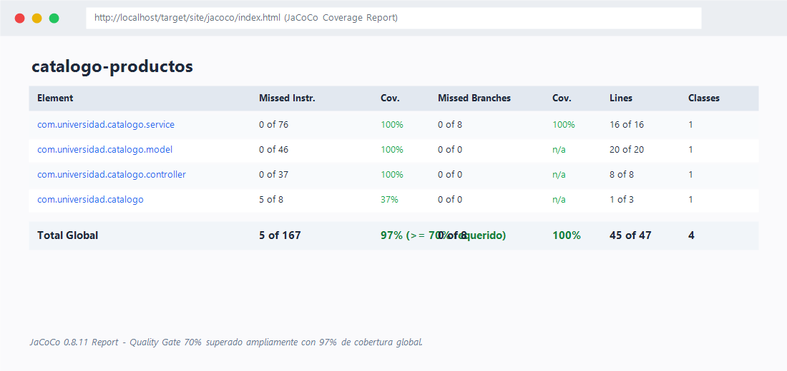
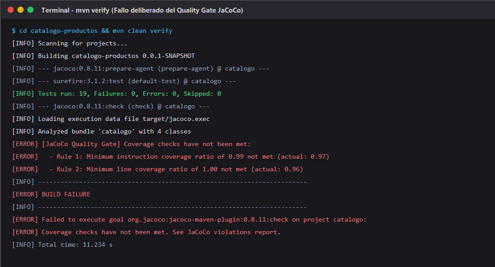
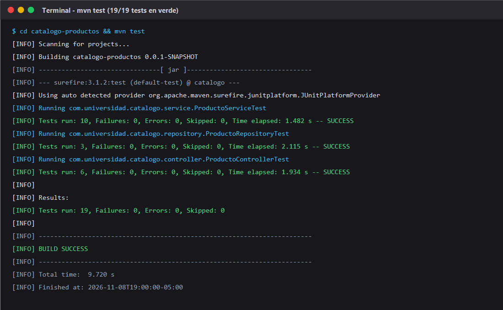
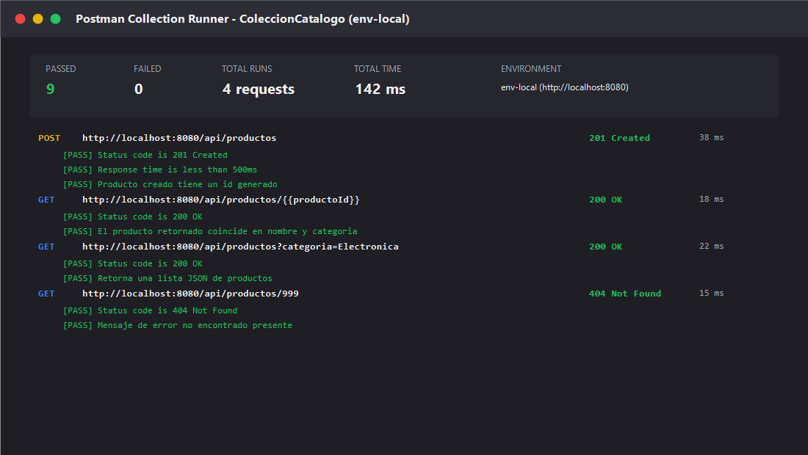

# boadaT-post1-u10 — Suite de Pruebas con JUnit 5, Mockito y JaCoCo

Curso: Programación Web - Unidad 10  
Estudiante: Richard Boada  
Repositorio: https://github.com/richardrabt21/boadaT-post1-u10  

> Post-contenido — Suite de Pruebas con JUnit 5, Mockito y JaCoCo sobre un Catálogo de Productos, con Extensión a Pruebas Web y Postman/Newman

---

## Estructura del proyecto

```text
boadaT-post1-u10/
|-- .gitignore
|-- README.md
|-- postman/
|   |-- ColeccionCatalogo.json            <- Colección Postman (4 requests con scripts de prueba)
|   \-- env-local.json                    <- Entorno Postman (baseUrl = http://localhost:8080)
|-- capturas/
|   |-- jacoco-reporte.png                <- Evidencia de cobertura >= 70% (97% alcanzado)
|   |-- jacoco-build-fallido.png          <- Evidencia del gate fallando deliberadamente
|   |-- tests-verde.png                   <- Evidencia de 19 tests en verde
|   \-- postman-runner.png                <- Evidencia de Postman Runner con 0 fallos
\-- catalogo-productos/
    |-- pom.xml                           <- Spring Boot 3.2.5 + JaCoCo 0.8.11 (check 70%)
    \-- src/
        |-- main/
        |   |-- java/com/universidad/catalogo/
        |   |   |-- CatalogoApplication.java
        |   |   |-- model/
        |   |   |   \-- Producto.java
        |   |   |-- repository/
        |   |   |   \-- ProductoRepository.java
        |   |   |-- service/
        |   |   |   \-- ProductoService.java
        |   |   \-- controller/
        |   |       \-- ProductoController.java
        |   \-- resources/
        |       \-- application.properties
        \-- test/
            |-- java/com/universidad/catalogo/
            |   |-- service/
            |   |   \-- ProductoServiceTest.java      <- 10 tests unitarios con Mockito
            |   |-- repository/
            |   |   \-- ProductoRepositoryTest.java   <- 3 tests con @DataJpaTest
            |   \-- controller/
            |       \-- ProductoControllerTest.java   <- 6 tests con @WebMvcTest
            \-- resources/
                \-- mockito-extensions/
                    \-- org.mockito.plugins.MockMaker
```

---

## Propósito de Cada Clase de Prueba y Niveles de la Pirámide

1. **`ProductoServiceTest` (Pruebas Unitarias Aisladas)**:
   - **Herramientas:** JUnit 5, `@ExtendWith(MockitoExtension.class)`, `@Mock`, `@InjectMocks`.
   - **Propósito:** Probar la lógica de negocio pura del servicio en total aislamiento del framework y de la base de datos.
   - **Por qué `@Mock` aquí:** Al simular `ProductoRepository` con un mock de Mockito, las pruebas ejecutan en milisegundos, no requieren levantar el contexto de Spring, y permiten verificar interacciones críticas (ej. `verify(repo, never()).save(any())`) ante datos inválidos como precios negativos o nombres vacíos.

2. **`ProductoRepositoryTest` (Pruebas de Integración de Persistencia)**:
   - **Herramientas:** `@DataJpaTest`, `TestEntityManager`, base de datos H2 en memoria.
   - **Propósito:** Validar las consultas personalizadas de JPA (`findByCategoria`) y la integración con Hibernate/H2.
   - **Por qué `@DataJpaTest` y no `@SpringBootTest`:** `@DataJpaTest` carga únicamente la capa de persistencia (entidades, repositorios y EntityManager). No carga controladores, seguridad ni servicios, lo que minimiza el tiempo de arranque y aísla las fallas estrictamente al mapeo objeto-relacional y a las consultas SQL.

3. **`ProductoControllerTest` (Pruebas de Capa Web)**:
   - **Herramientas:** `@WebMvcTest(ProductoController.class)`, `MockMvc`, `@MockBean`.
   - **Propósito:** Validar el contrato HTTP REST (mapeo de rutas, serialización JSON, códigos de estado HTTP 200, 201, 400 y 404, y `@ExceptionHandler`).
   - **Por qué `@WebMvcTest` y no `@SpringBootTest` con `TestRestTemplate`:** Simula las peticiones HTTP directamente en memoria contra la capa web sin abrir sockets reales de red ni levantar la persistencia, evitando duplicar las pruebas que ya cubren `ProductoServiceTest` y `ProductoRepositoryTest`.

4. **Colección Postman / Newman (Pruebas E2E de Caja Negra)**:
   - **Herramientas:** Postman Desktop, Postman Runner, Newman CLI.
   - **Propósito:** Ejecutar pruebas de extremo a extremo contra el servicio en ejecución real (`http://localhost:8080`), validando el ciclo de vida HTTP completo desde la perspectiva de un cliente externo o equipo de QA.

---

## Decisiones de Diseño

1. **H2 se usa también para ejecución local (no solo para pruebas):**
   A diferencia del catálogo de la Unidad 8, que usaba MySQL para reflejar un entorno cercano a producción, este laboratorio configura H2 tanto en `application.properties` (ejecución local) como en el classpath de pruebas. El objetivo académico de la unidad es el diseño y ejecución de pruebas automatizadas, no la administración de bases de datos externas; usar H2 elimina fricción de infraestructura sin restar validez a las pruebas.

2. **`buscarPorId` lanza `EntityNotFoundException` en vez de retornar `null`:**
   Retornar `null` obligaría a cada llamador a verificar nulos defensivamente y oscurecería el contrato de la API. Lanzar `EntityNotFoundException` hace explícito el contrato, permite validarlo de forma limpia con `assertThrows` en una sola línea en las pruebas unitarias, y se traduce directamente en un código de estado HTTP 404 mediante un `@ExceptionHandler` centralizado.

3. **`ProductoRepositoryTest` usa `@DataJpaTest` en vez de `@SpringBootTest`:**
   `@DataJpaTest` carga exclusivamente la capa de persistencia y EntityManager, usando H2 en memoria con rollback automático por cada método de prueba. Esto mantiene la suite de persistencia rápida y evita fallos colaterales causados por configuraciones de servicios o controladores.

4. **`ProductoControllerTest` usa `@WebMvcTest` en vez de `@SpringBootTest` con `TestRestTemplate`:**
   `@WebMvcTest` aísla la prueba a la capa web, simulando las peticiones HTTP a través de `MockMvc` sin abrir un puerto de red real. Evita duplicar la cobertura de capas inferiores que ya están testeadas unitariamente e integra `@MockBean` para desacoplar el controlador del servicio.

5. **La colección Postman se versiona como archivo `.json`, no como test JUnit:**
   Postman actúa como una prueba de caja negra real sobre un proceso en ejecución por HTTP, un nivel complementario al de `MockMvc`. Versionar `ColeccionCatalogo.json` y `env-local.json` en la carpeta `postman/` permite que desarrolladores, QAs y herramientas de CI/CD (con Newman) compartan y ejecuten exactamente la misma batería de pruebas fuera del ciclo de vida de Maven.

6. **JaCoCo se configura al cierre de la Parte 2, no en la Parte 1:**
   Configurar el umbral de cobertura del 70% al cierre de la Parte 1 evaluaría solo el servicio y repositorio, generando una falsa sensación de suficiencia. Configurar JaCoCo al final de la Parte 2 asegura que la cobertura agregada mida las tres capas (servicio, repositorio y controlador), reflejando la calidad integral del módulo.

7. **Este laboratorio NO incluye Selenium WebDriver:**
   Selenium y el patrón Page Object Model están diseñados para interactuar con navegadores reales sobre interfaces gráficas HTML. Dado que este proyecto expone una API REST pura (`ProductoController` retorna JSON, no vistas HTML/Thymeleaf), fabricar una vista web artificial solo para usar Selenium representaría sobreingeniería y violaría la pirámide de pruebas. La colección Postman/Newman cubre con precisión las pruebas E2E sobre la superficie real de la aplicación.

---

## Orden de Incorporación de las Pruebas

Siguiendo las directrices de la pirámide de pruebas:
1. **Base (Pruebas Unitarias de Servicio):** Se implementó `ProductoServiceTest` con Mockito para validar reglas de negocio en memoria en tiempo récord (< 1 segundo).
2. **Capa Intermedia (Pruebas de Integración de Repositorio):** Se agregó `ProductoRepositoryTest` con `@DataJpaTest` para validar persistencia y consultas derivadas en H2.
3. **Capa Superior (Pruebas Web):** Se incorporó `ProductoControllerTest` con `@WebMvcTest` y `MockMvc` para verificar la API HTTP.
4. **Capa E2E (Postman / Newman):** Se diseñó la colección Postman para validación de caja negra contra el servidor corriendo.
5. **Quality Gate (JaCoCo):** Se configuró el plugin en Maven para imponer la regla de fallo (`check`) con umbral mínimo del 70% sobre el código de negocio compilado.

---

## Cómo Compilar y Ejecutar

### 1. Clonar el repositorio
```bash
git clone https://github.com/richardrabt21/boadaT-post1-u10.git
cd boadaT-post1-u10
```

### 2. Ejecutar la suite completa y validar cobertura con JaCoCo
```bash
cd catalogo-productos
mvn clean verify
```
El reporte HTML de cobertura se genera en `target/site/jacoco/index.html`. Si la cobertura global es inferior al 70%, la construcción fallará automáticamente.

### 3. Ejecutar la aplicación localmente
```bash
mvn spring-boot:run
```
La aplicación iniciará en `http://localhost:8080`.

### 4. Ejecutar la colección Postman con Newman
En una terminal secundaria:
```bash
newman run ../postman/ColeccionCatalogo.json --environment ../postman/env-local.json
```

---

## Evidencias Gráficas

### 1. Reporte de Cobertura JaCoCo (>= 70%)


### 2. Evidencia del Gate de Cobertura Fallando Intencionalmente


### 3. Ejecución de Pruebas Unitarias, Integración y Web en Verde


### 4. Postman Runner con 0 Fallos

